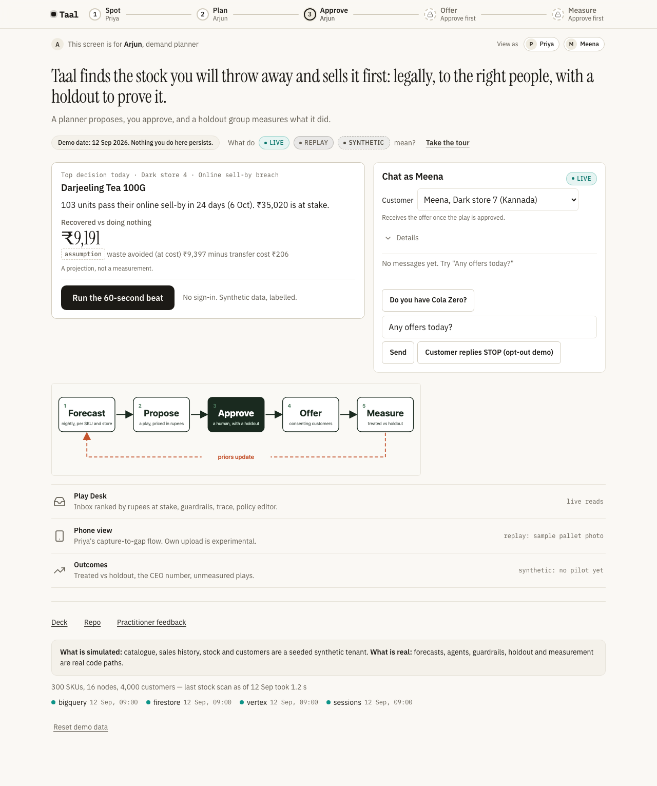
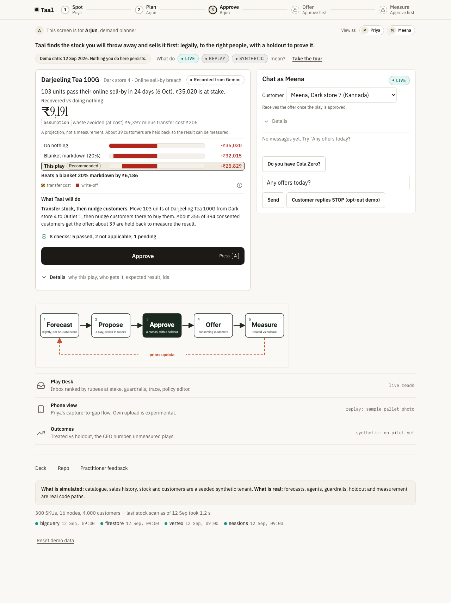
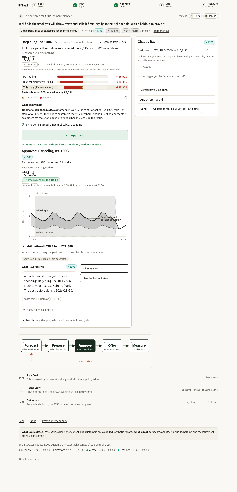
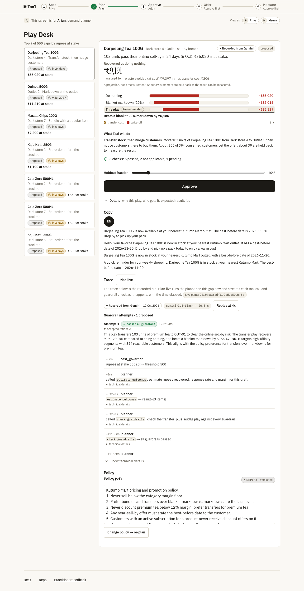
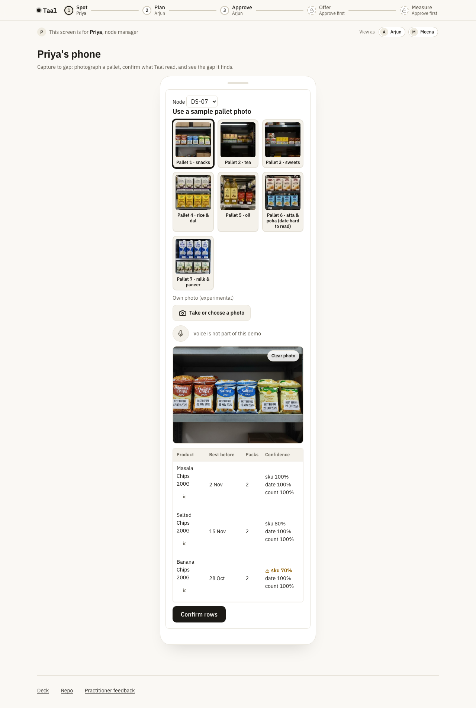
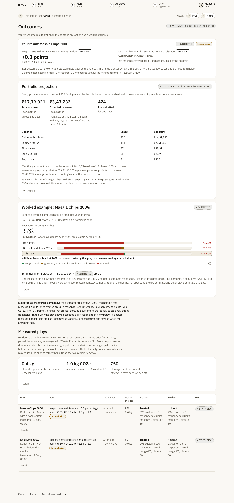

# Taal

Forecast, propose, approve, offer, measure: one loop that sells at-risk stock before it is written off, with a holdout to prove it.

**₹9,191 recovered on the hero play, projected** (one tea lot on a seeded tenant, versus doing nothing; Gemini 3.5 Flash plans, code prices every rupee). [Live app](https://taal-web-2obkp776ca-el.a.run.app) · [Deck](docs/deck.pdf) · Video (link added at submission) · [API health](https://taal-agents-2obkp776ca-el.a.run.app/health)


Retail & Commerce entry for the Google Cloud AI Builder Cup 2026 (JAPAC).

## Judge quick-start

Three clicks to the result, then chat. Open https://taal-web-2obkp776ca-el.a.run.app (first load takes 8 to 12 s; deployed via `infra/deploy.sh`; the local demo runs with `make api` + `make web`, see Development). The demo clock is pinned to 12 Sep 2026, so the 6 Oct sell-by is in the future of the demo.
1. Click **Run the 60-second beat**. The Darjeeling Tea card (`gap_tea_ds04`) shows 103 units, ₹35,020 at stake, 24 days to the online sell-by.
2. Click **Approve** (about 3 to 7 s; measured 12 Oct after #90, first call after idle takes longer). The headline reads "Recovered vs doing nothing ₹9,191", with 355 customers treated and 39 held out (394 consented; seeded). The play still nets -₹25,829 against ₹35,020 at stake; ₹9,191 is the improvement over doing nothing, a projection on a seeded tenant.
3. Click **Chat as Ravi** and the offer arrives. Then click **Send** and **Add to cart**: the order total is ₹450. Chat answers come from the inventory tool and carry the best-before date.

Live re-plan about 27 s, Approve about 3 to 7 s (measured 12 Oct after #90; first call after idle takes longer); evidence in [`eval/evaluation.md`](eval/evaluation.md#latency-one-story-gemini-35-flash-12-oct-2026).

Demo video: link added at submission

- Deck: [`docs/deck.pdf`](docs/deck.pdf)
- Reset demo data restores the seeded tenant for your visitor only.
- Provenance badges: every panel carries a LIVE, REPLAY or SYNTHETIC badge (no REAL PILOT rows exist, so none is shown); the Desk's trace and re-plan result name the run's source instead (`Recorded from Gemini · <date>`, `Scripted fixture`, `Rules (fallback)` or `Live · Gemini`). Approve, chat, capture and execution are live calls; Sense is nightly and replayed. **Change policy → re-plan** is a live, streamed Gemini call on the deployed service.
- What is real and what is simulated: see [the table](#what-is-real-what-is-simulated).

## How Gen AI is used

Gemini 3.5 Flash on Vertex AI plans each play inside an ADK agent. It proposes the mechanic, the audience and the reasoning; plain code prices every rupee, runs eight guardrails over the proposal, assigns the holdout and measures the lift. A proposal that fails a guardrail is sent back for a revision (up to 3 iterations) instead of being shown.

| Component | Model (id in `config/models.toml`) | What it decides | Deliberately not LLM |
|---|---|---|---|
| Vision intake | `flash` | SKU, best-before date, facings, confidence | which rows need confirmation (threshold); the sell-by date (rule) |
| Planner | `flash` in a LoopAgent | mechanic, audience, rationale, alternatives, revision after a failed guardrail | every rupee (estimator), guardrails, holdout, play validity |
| Copy | `flash` via BigQuery `AI.GENERATE_TABLE` (vertex backend only, at approve time; falls back to templates on any failure/timeout) | vernacular variants | discount values, best-before disclosure (validator; runs on generated and templated copy alike) |
| Customer agent | `flash` | dialogue, substitution reasoning, envelope | stock, offer eligibility, arm, consent, order prices |
| Measure, Sense, Approve | none | | lift, CI, priors, assignment, forecast |

`TAAL_MODEL_BACKEND=stub` (the default, what CI runs) replaces Gemini with scripted models that follow the same tool protocol, so the agents, tools, session state and event log are the real code paths. `vertex` uses the pinned Gemini ids through Vertex AI; ids live only in `config/models.toml`.

**Recorded trace.** The 60-second beat opens on `gap_tea_ds04`: 103 units of Darjeeling Tea 100G at dark store DS-04, ₹35,020 at stake, online sell-by 6 October 2026. Its Desk trace is a real, committed Gemini recording, badged `Recorded from Gemini · 12 Oct 2026`: five independent live Vertex runs (`gemini-3.5-flash`, prompt v6) all reached `proposed` with 0 fallbacks in 21.9 to 26.7 s, each after one schema-rejected `propose_play` attempt (`eval/raw/planner_real_traces_tea_2026-10-12/`). The play is a transfer of the 103 units to OUT-01 plus a nudge to 394 consented customers, expected margin ₹9,191 (waste avoided ₹9,397 minus transfer cost ₹206), and it passed all eight guardrails. It beats a blanket 20% markdown by ₹6,186, but it still nets -₹25,829 against ₹35,020 at stake: ₹9,191 is the improvement over doing nothing (`eval/raw/tea_recorded_beat_2026-10-12.json`). Approval assigns 355 treated and 39 holdout customers by hash.

The second recorded gap, `gap_chips_ds07` (recorded 10 Oct 2026), does not beat the baseline: -₹8,468 against -₹8,189 for a blanket 20% markdown, about ₹279 worse, and the Desk shows both. Both plays in full, and the live re-plan timings: [`docs/hero_plays.md`](docs/hero_plays.md).

**Live Plan run.** On the deployed service, 11 Oct, on `gemini-3.5-flash`: 22 of 24 runs model-planned, 0 fallbacks, planner p50 26.5 s, p95 31.8 s. The other 2 were not observed (the first poll returned 404 from a second instance, so their outcome is unknown); they count as not passed and are not fallbacks (`eval/raw/plan_live_2026-10-12.md`).

## Team

| Name | Role |
|---|---|
| Nandish | Lead, product and engineering |
| Rinu | Co-builder |

## Impact in numbers

Every number is reproduced from a committed evidence file or a named code constant; the full table with sources is in [`docs/impact_numbers.md`](docs/impact_numbers.md). Measured 2026-09-24 on the seeded tenant.

| What | Number | Label | Source |
|---|---|---|---|
| 28-day exposure, one Sense run (555 gaps: 550 grocery plus 5 assortment rows, ₹16,443 of the exposure, that the current generator no longer makes) | ₹1,795,464 | seeded | `eval/raw/portfolio_2026-09-24.json` |
| Plays planned | 424 | seeded | same file |
| Expected margin per 28-day run at the default 5% response prior (sales margin ₹206,205 plus write-off avoided ₹141,151) | ₹347,356 | projected | same file; `docs/impact_math.md` |
| The same estimate at a 2% / 10% response prior instead of 5% (550 grocery gaps; 421 / 423 plays) | ₹140,728 / ₹619,165 | projected | `eval/raw/portfolio_prior_sensitivity_2026-10-09.json` |
| Monthly run cost: usage measured to 2026-09-23 with zero plays in the window, on gemini-2.5-flash, list-priced | ₹486 | measured usage; not a bill | `eval/raw/cost_measurement_2026-09-23.json` |
| Forecast backtest: synthetic tenant / public non-grocery data | WAPE 0.113 / 0.83 | seeded / public | `eval/raw/external_backtest_2026-10-09.json`; [`eval/external_backtest.md`](eval/external_backtest.md) |

India scale, as reported by Inc42 (22 Jul 2026): Blinkit's inventory losses (expiry, shrinkage, damage, pilferage, transit) are about 1.8% of net order value. With the same article's Q1 NOV of ₹17,132 crore and 2,443 stores, that is ₹17,132 crore / 2,443 = ₹7.01 crore per store per quarter, x 4 x 1.8% = about ₹0.5 crore of inventory loss per store per year. This is all inventory loss, not only near-expiry stock, and it annualises one quarter: context for scale, not a Taal result.

Buyer and pricing basis: the buyer is the category or supply-chain head, who owns write-off; the basis is a fee per dark store per month or a percentage of rupees rescued against the holdout. No price point is set until a pilot measures that lift.

Payback illustration, synthetic and projected, not a quote: the ₹347,356 is per 28-day run at the 5% prior; divided by 16 nodes it is about ₹21,710 per node per 28-day run. Against the ₹486 measured run cost (a floor: no plays ran in that window) the break-even is about ₹21,710 - ₹30 per node; against the Mid profile estimate of ₹2,500 to 5,000 a month (`docs/scale.md`) it is about ₹21,710 - ₹156 to ₹313 per node.

## Screenshots

Captured with Playwright against the real local stack (`make api` + `make web`, mock mode off, stub model backend); `web/tests/live/screens.spec.ts` reproduces them. None of the images or the phone view's eight sample pallet photos is a real camera photo: they are AI-generated renders (`fixtures/photos/README.md`), and vision accuracy on real photos has not been measured.

| | |
|---|---|
|  Judge mode landing |  60-second beat: gap card |
|  60-second beat: approved, chart moved |  Play Desk |
|  Phone view: intake table |  Outcomes: measured |

## The hook

FSSAI, India's food regulator, sent e-commerce food business operators an advisory on 3 December 2024 ([file no. RCD-13/1/2024-Regulatory-FSSAI(E-13150)](https://fssai.gov.in/upload/advisories/2024/12/674efa161d756Adobe%20Scan%203%20Dec%202024.pdf), paragraph 4): "FSSAI mandates that products must have a minimum shelf life of 30% or at least 45 days before expiry, at the time of delivery." It is an advisory, not a gazetted rule, and it leaves open 30% of what, and whether the two limits are alternatives or cumulative. **The reading below is Taal's configurable default, not FSSAI text.** Taal applies it as a tenant-set, versioned rule (`config/tenant.demo.toml`, `sellby_rule`); on the demo tenant either limit satisfies it, so a 90-day-shelf-life pack of chips that expires in **33 days** needs 27 days left (30% of 90) and can be sold online for **6** more days. Forecasting tools treat expiry as the deadline; Taal makes the online sell-by cut-off a first-class gap type, shown on every gap card.

## Architecture


Two paths: a per-visitor sandbox serves judges, and nightly Cloud Run jobs run on BigQuery
(source and request paths in [`docs/architecture.md`](docs/architecture.md)).

## More documentation

- [`docs/design_notes.md`](docs/design_notes.md): why the loop generalizes beyond promos, and what Gemini decides versus what code never lets it decide.
- [`docs/vendors.md`](docs/vendors.md): how Taal differs from named vendors (public pages read 2026-10-09).
- [`docs/related_work.md`](docs/related_work.md): outside references, and consent and approval in AP2 vocabulary.
- [`docs/hero_plays.md`](docs/hero_plays.md): the Tea and chips recordings in detail.
- [`docs/codespaces.md`](docs/codespaces.md): running it in GitHub Codespaces.

## What it does

1. **Capture**: a node manager photographs a pallet; dates and counts are read with confidence scores; low-confidence rows must be confirmed before they reach inventory.
2. **Sense** (nightly): per-SKU, per-node forecasts with promo and festival regressors; six gap types (five write-off-risk types from the forecast, plus unmet demand from real chat requests) with rupees at stake.
3. **Plan**: an ADK Planner Agent (LlmAgent in a LoopAgent, max 3 iterations) designs a play with six deterministic tools; every number comes from the estimator and eight guardrails gate it.
4. **Approve**: assignment with a holdout, copy with the best-before line, offers for treated customers only, the play written into the forecast, the chart moves.
5. **Engage**: a Customer Agent grounded in node stock, offers and consent; orders go through an MCP order endpoint; STOP withdraws consent.
6. **Measure**: treated vs holdout inside the play window with a 95% CI, `unmeasured` when the treated arm is too small, estimator priors updated from the exact counts.

## What is real, what is simulated

BigQuery batch path status and the 27 Sep incidents: [eval/incidents_2026-09-27.md](eval/incidents_2026-09-27.md).

| Part | Status | What it is, and the evidence |
|---|---|---|
| Judge-mode data path | Real | A frozen, pinned-clock local snapshot per visitor; Reset restores it. |
| Forecasts, gaps, estimator, guardrails, planner loop | Real | Local seasonal-xreg forecaster (`jobs/sense/forecast.py`), gap detector, estimator, eight guardrails and the ADK planner code run for real. |
| Approve, chat, orders, measurement code | Real | Assignment by hash, re-forecast, chat with Gemini, MCP orders into the local store, and the lift and CI code. |
| Nightly BigQuery jobs | Real, not on the judge path | `AI.FORECAST` lost 45/45 head-to-head to the local forecaster, so the judge-facing path uses the local one; the nightly `taal-sense` job still runs it (`infra/deploy.sh:309`) and its output is not read by that path (`eval/raw/bigquery_ai_forecast_2026-09-27/head_to_head_summary.json`). |
| Kutumb Mart tenant | Seeded | 300 grocery SKUs, 10 dark stores, 6 outlets, 4,000 customers, 70 days of sales history (`eval/raw/docs_truth_sweep_2026-09-27/tenant_counts.json`). |
| Tea and chips plays | Seeded (recorded Gemini runs) | Committed recordings: Tea 12 Oct (`eval/raw/planner_real_traces_tea_2026-10-12/`), chips 10 Oct (`eval/raw/planner_real_traces_2026-10-10/`). |
| Cola, kaju and quinoa plays | Seeded (scripted fixture) | Seeded from the scripted planner fixture (`infra/Dockerfile.api`). |
| Expected margin and write-off avoided after Approve | Projected | At the default response prior; a projection on a seeded tenant. |
| Outcomes screen | Synthetic | Labelled SYNTHETIC until a pilot runs (`docs/pilot.md`). |

Deployment caveat: `taal-agents` runs with `--max-instances 1` (`infra/deploy.sh:239`) because each visitor's sandbox lives on the instance's local disk (`services/api/sandbox.py`) and re-plan run state lives in process memory; a second instance would not see a visitor's earlier writes and would answer a poll with 404. `min-instances` stays 0, so the first request after idle is slower.

## Production path

- **Scalability (estimate):** the Large profile (20,000 SKUs, 500 nodes, 1M customers, about 2,000 gaps a night after triage) keeps the same shape; only the Planner queue depth, BigQuery partition pruning and the triage threshold scale. No tenant that size has run, so its throughput is not measured ([`docs/scale.md`](docs/scale.md)).
- **What breaks first:** `taal-agents` is pinned to `--max-instances 1` because the per-visitor sandbox is on local disk and re-plan run state is in process memory (moving both to shared storage is the fix), so one instance is the ceiling before anything else; then the Planner fan-out queue past a few thousand gaps a night if triage is set too low, then the in-process re-forecast under many concurrent Approves (`docs/scale.md`, "What breaks first").
- **Run cost:** ₹486 a month measured on the demo tenant (usage to 23 Sep, no plays in the window, list prices, not a bill). Estimates by profile: Micro ₹200 to 500, Mid ₹2,500 to 5,000 (the demo persona), Large ₹1 to 2 lakh.
- **Pilot design:** 50 to 60 consented testers for one week, a 40 to 50% holdout, the metric pre-registered, results labelled apart from seeded numbers ([`docs/pilot.md`](docs/pilot.md)). Nothing has been measured on real customers yet.
- **Your data:** `uv run python -m data.ingest --products products.csv --batches inventory_batches.csv --sales sales.csv --tenant config/tenant.<name>.toml --out .local/data-<name>` (details below).

## Not in this submission

Voice (Gemini Live) is not part of this submission: it is a documented stub with no tests, and the phone view's microphone button is disabled.

## Bring your own data

- **Three files**: `products.csv`, `inventory_batches.csv`, `sales.csv` (columns in [`docs/scale.md`](docs/scale.md#the-three-csv-ingestion-contract); example in [`data/samples/`](data/samples/)); `nodes.csv` and `inbound.csv` are optional.
- **One command**: the `data.ingest` command above (copy `config/tenant.demo.toml` to set your sell-by rule, margin floors and thresholds). It flags every lot under your online sell-by rule, with rupees at stake by gap type; errors name the file, line and column; nothing leaves the machine.
- **Pilot**: `TAAL_DATA_DIR=.local/data-<name> TAAL_TENANT_CONFIG=config/tenant.<name>.toml make api` serves those gaps over the same API. Planning a play returns `no_play` until customer and consent tables exist, because the three files carry no audience; that is the pilot's first step ([`docs/pilot.md`](docs/pilot.md)).

## Evaluation

[`eval/evaluation_table.md`](eval/evaluation_table.md) is the submission table, built by `make eval-table` from `eval/evaluation.md` and `eval/raw/`: every cell is parsed from committed output, none is typed by hand. Rows this project cannot produce yet (pilot results, billing-export cost) say so.

From 10 Oct 2026 the live model is `gemini-3.5-flash` in asia-south1 (`gemini-2.5-flash` retires on Vertex on 20 Oct 2026), with `gemini-3.5-flash-lite` as its fallback, both verified with real calls (`eval/raw/model_verification_2026-10-10.json`). Eval cards from before the switch ran on `gemini-2.5-flash` and have not been re-run: the 9 Oct live eval (ADK response match 38/46, exact trajectory 6/46, rationale judge 15/15; `eval/raw/live_eval_2026-10-09/`), the agent simulation, vision and customer-latency runs, and the cost figure.

Live plan results are in [How Gen AI is used](#how-gen-ai-is-used). Latency numbers and test counts (464 pytest, 473 Playwright, in `make verify`): [`eval/evaluation.md`](eval/evaluation.md#latency-one-story-gemini-35-flash-12-oct-2026).

## Development

```
make setup      # uv sync + npm ci (Playwright uses the pre-installed Chromium)
make verify     # secrets -> lint -> schemas -> generate -> unit -> sql -> agents -> api-test -> web-test -> docs -> status
make api        # FastAPI on :8080 against .local/data
make web        # Next.js on :3000 (NEXT_PUBLIC_TAAL_MOCK=1 for fixtures only)
make fixtures   # rebuild committed golden plays, mutations, golden runs, evalsets
make openapi    # regenerate docs/openapi.yaml
```

Green `make verify` (464 pytest and 473 Playwright tests, the CI gate in `.github/workflows/verify.yml`) is the only definition of done (`harness/`, `STATUS.md`). Specs: `docs/DECISIONS.md`; data model: `docs/DATA_MODEL.md`; architecture: `docs/architecture.md`; scale and cost: `docs/scale.md`; pilot: `docs/pilot.md`; privacy: `docs/privacy.md`; API: `docs/openapi.yaml`.

## Licence

MIT for code (`LICENSE`). Third-party data terms in `DATA_LICENSES.md`.
