# Taal

Taal turns a retailer's write-off forecast into a human-approved, holdout-tested offer for the right customers.

On the live Desk: 103 packs of Darjeeling Tea, 24 days to the online sell-by, ₹35,020 at stake.

Forecast, Propose, Approve, Offer, Measure. Retail & Commerce entry, Google Cloud AI Builder Cup 2026.

| Result | Figure | Label |
|---|---|---|
| Adversarial eval | 20 attacks + 6 genuine controls, 3 runs each: 50 of 60 attack runs stopped, 0 of 18 genuine runs refused. After fixes (C8 consent write, V3 screen photo, P3 echo) the consent write is blocked 3/3; V6 (cropped label) is not fixed. [Details](eval/evaluation.md#adversarial-cases-14-oct-2026-frozen) | MEASURED, `gemini-3.5-flash`, 14 Oct; fixes land with the final batch |
| Model Armor | Screens every customer chat message and reply (prompt injection, jailbreak, RAI); verified live 14 Oct: an injection prompt is refused before the agent runs | MEASURED, `taal-agents-00149-sw6`, 14 Oct |
| Live Plan | 22/24 Gemini-authored, p50 26.5 s | MEASURED, `gemini-3.5-flash`, prompt v6, 11 Oct |
| Planner evalsets | First proposal accepted 39/46; strict trajectory 18/46 against same-model expectations (a regression guard, not accuracy) | MEASURED, `gemini-3.5-flash`, prompt v7, re-recorded 14 Oct |
| Accessibility | 0 serious or critical axe findings in 20 first-paint scans | MEASURED, mock mode, 14 Oct |
| Approve | 1.4 to 1.7 s warm | MEASURED, 13 Oct, `taal-agents-00143-8v9` |
| Chat latency (pending measurement) | to be filled | NOT YET MEASURED |
| Hero play vs doing nothing | **₹9,191** recovered | PROJECTED, synthetic |
| Beat a blanket 20% markdown | **₹6,186** | PROJECTED, derived |
| Holdout | 355 treated, 39 held out; lift +0.3 pp, 95% CI -8.7 to +1.6 | inconclusive, synthetic |
| Tests | 500+ pytest, 600+ Playwright cases | `make verify` gate |

Sources (`eval/raw/`): `adversarial_2026-10-14*/`, `model_armor_live_check_2026-10-14.md`, `plan_live_2026-10-12.json`, `live_eval_2026-10-14/`, `approve_timing_2026-10-13c.json`, `tea_recorded_beat_2026-10-12.json`; `web/tests/axe_report_2026-10-14.md`.

## Judge quick-start

No sign-in. Each visitor has a private sandbox; Reset restores it. The demo clock is pinned to 12 Sep 2026. After idle, the first load can take about 10 s.

1. Open <https://taal-web-2obkp776ca-el.a.run.app> and click **Run the 60-second beat**. You land on the Darjeeling Tea gap (103 units, ₹35,020 at stake).
2. Click **Approve**. The headline reads "Recovered vs doing nothing ₹9,191" (projected), with 355 customers treated and 39 held out. The play still nets -₹25,829 against ₹35,020 at stake; ₹9,191 is the gain over doing nothing.
3. Click **Chat as Ravi**, then **Send** and **Add to cart**. The offer arrives and the order total is ₹450.

Also try **Plan live** (a live Gemini re-plan, about 27 s).

| Live app | Video | Deck | Repo | API health |
|---|---|---|---|---|
| [taal-web](https://taal-web-2obkp776ca-el.a.run.app) | [Demo video (2:37)](https://drive.google.com/file/d/1vL2_t9pFg4fiMYkumUqtepM3VfA5s2a5/view?usp=sharing) | [PDF](docs/deck.pdf) | [GitHub](https://github.com/Nandish3010/probable-fortnight) | [/health](https://taal-agents-2obkp776ca-el.a.run.app/health) |

## How Gen AI is used

Gemini 3.5 Flash (`gemini-3.5-flash`) on Vertex AI in asia-south1 does the language and judgement work. The fallback `gemini-3.5-flash-lite`, on the global endpoint, runs only when the primary answers 404, 429 or 5xx (`config/models.toml`).

- **Planner.** An ADK `LlmAgent` inside a `LoopAgent` (up to 3 iterations) with six deterministic tools proposes the mechanic, audience and rationale for each at-risk lot. A rejected proposal is sent back with the reason.
- **Eight guardrails** reject a play when: margin is under the category floor; a customer is at the frequency cap (2 plays in 7 days); the audience lacks marketing consent; near-deadline copy lacks the sell-by line; subscribers sit in a discount audience; it pushes a SKU with an open stockout gap; the holdout is missing or invalid; or a rationale number appears nowhere in the play's fields (cite-or-drop).
- **Vision intake.** Gemini reads a pallet photo into SKU, the date printed on the pack and facings, each with a confidence; rows under 70% need a human to confirm.
- **Customer agent.** Chat in English and Kannada (with an English gloss), orders through an MCP order tool, STOP withdraws consent, a holdout persona sees no offer.

| The model decides | Code decides |
|---|---|
| mechanic, audience, rationale; revision after a rejection | every rupee (estimator), the eight guardrails, the holdout and its assignment |
| SKU, date and facings read from a photo | which rows need confirmation; the sell-by date (a rule) |
| dialogue and substitution reasoning | stock, eligibility, consent, order prices |

Detail: [`docs/gen_ai_detail.md`](docs/gen_ai_detail.md).

## Evidence

| Measure | Result |
|---|---|
| ADK evalsets, 14 Oct | Response match **46/46**, strict trajectory **18/46**, first proposal accepted **39/46** (`gemini-3.5-flash`, prompt v7); IN_ORDER match 33/46. Expectations were re-recorded from one run of the same model (`agents/planner/evalsets/PROVENANCE.json`): a regression guard, not accuracy |
| Dated history, 12 Oct | 43/46 response match and 1/46 strict trajectory (`gemini-3.5-flash`, prompt v6) against the 28 Sep `gemini-2.5-flash` recordings; 9 Oct: 38/46 and 6/46 (pre-switch). The 28 Sep set is at `git show 6482e7c:agents/planner/evalsets/<file>` |
| Rationale judge | 15/15, mean 5.0 (`gemini-3.5-flash`, prompt v6, 12 Oct), by a same-family judge (weak evidence) |
| Live Plan, deployed | 22 of 24 model-planned, 0 fallbacks, p50 26.5 s, p95 31.8 s (`gemini-3.5-flash`, prompt v6, 11 Oct); 2 runs lost to a cold-instance 404 count as not passed. Not repeated on v7 |

**Learning curve.** [`docs/learning_curve.md`](docs/learning_curve.md) lists what we measured, what we changed and what the next run said, including the changes that made a number worse.
On 14 Oct: re-recorded evalsets, the adversarial eval and fixes, Model Armor live, and a fair backtest (unchanged forecaster all-days WAPE 1.119, 1.839 without the pre-registered exclusion, vs 0.907 for a 28-day mean; a zero-filled variant was measured, not shipped).
Chat latency on 14 Oct was p50 4.45 s, p95 8.70 s, worse in the tail than 6.48 s before the switch.

**Tests:** 511 pytest functions (293 unit, 112 agents, 53 API, 31 SQL, 22 contract) plus 575 e2e and 32 live Playwright cases (grep, 14 Oct). **CI:** `make verify` gates every pull request; `main` deploys only when green, then a smoke job runs.

**Approve (13 Oct):** 2.1 to 2.5 s warm, then 1.4 to 1.7 s (five warm samples, not a percentile).

Pre-switch cards (`gemini-2.5-flash`, not re-run since the 10 Oct switch): agent simulation 190/190 (21 Sep), vision 30/30 on synthetic photos (21 Sep), chat p50 4.56 s, p95 6.48 s (50 calls, 28 Sep), run cost ₹486 (usage to 23 Sep). Narrative: [`docs/eval_narrative.md`](docs/eval_narrative.md), [`eval/evaluation.md`](eval/evaluation.md).

## What is real and what is simulated

| Component | Status | What it is |
|---|---|---|
| Forecast and gaps | SYNTHETIC | local forecaster over seeded Kutumb Mart history; the judge path does not read the nightly BigQuery output |
| Plays | RECORDED, SCRIPTED | Tea (12 Oct) and chips (10 Oct) are committed Gemini runs; cola, kaju and quinoa are scripted; Plan live is a LIVE Gemini call |
| Offers | LIVE | treated customers only, consent and STOP enforced by code, on a SYNTHETIC audience |
| Orders | LIVE, SYNTHETIC | chat and the MCP order call run live; the order lands in your sandbox |
| Holdout | LIVE, SYNTHETIC | assignment by hash is live; the result is one fast-forwarded synthetic order |
| Customers | SYNTHETIC | 4,000 customers, 300 SKUs, 16 nodes, one fictional tenant |
| Photos | SCRIPTED | eight AI-generated samples replay recorded reads; a real upload is live and experimental |
| Copy | RECORDED | BigQuery-generated ahead of time and stored; the validator runs live |

The app's badges are LIVE, REPLAY (RECORDED here) and SYNTHETIC. No pilot has run.

## Architecture

| Service | What it decides or stores |
|---|---|
| Cloud Run `taal-web`, `taal-agents` | the app, and the API with per-visitor sandboxes; `min-instances` 0, `max-instances` 1 |
| Vertex Gemini | the proposal, the pallet-photo read and the customer chat |
| ADK | the planner loop and its six tools |
| BigQuery | the nightly forecast job; offer copy is pre-generated with `AI.GENERATE_TABLE`, stored and reused at Approve |
| Firestore | practitioner feedback |
| MCP order tool | places the order from chat |
| Cloud Scheduler | nightly jobs, plus keep-warm pings |

Model moved off `gemini-2.5-flash` on 10 Oct (retires 20 Oct). Request paths: [`docs/architecture.md`](docs/architecture.md).

## Impact and limits

FSSAI's advisory of 3 Dec 2024 ([file RCD-13/1/2024-Regulatory-FSSAI(E-13150)](https://fssai.gov.in/upload/advisories/2024/12/674efa161d756Adobe%20Scan%203%20Dec%202024.pdf)) asks e-commerce food operators to deliver with a minimum of 30% shelf life or 45 days left. It is an advisory, not law; Taal's either-limit reading is its own default (`config/tenant.demo.toml`).

As reported by Inc42 (22 Jul 2026), Blinkit's inventory losses were about 1.8% of net order value (₹17,132 crore, 2,443 stores): about ₹0.5 crore per store per year. It covers all inventory loss and annualises one quarter: context, not a Taal result.

In our survey, 3 of 7 practitioners write off stock weekly or daily.

Projected margin per node (16 nodes), per 28-day run, at a 2% / 5% / 10% response prior, from tenant totals of ₹1.41 / 3.47 / 6.19 lakh (`portfolio_prior_sensitivity_2026-10-09.json`, `docs/impact_numbers.md`). Annualised, 28-day figure x 365/28:

| Response prior | Per node, 28-day run | Per node, per year (projected) |
|---|---|---|
| 2% | ₹8,796 | 8,796 x 365/28 = ₹114,662 (₹1.15 lakh) |
| 5% | ₹21,710 | 21,710 x 365/28 = ₹283,005 (₹2.83 lakh) |
| 10% | ₹38,698 | 38,698 x 365/28 = ₹504,456 (₹5.04 lakh) |

Projected, synthetic tenant.

**Fair-use limits.** The public demo limits model calls to protect the Gemini budget. Per 15 minutes, all visitors share 120 plan runs, 600 chat turns and 60 photo reads; each visitor gets 20 plan runs, 60 chat turns and 10 uploaded photos (about 20 MB each). Sample photos are unlimited. A limit returns HTTP 429 with `Retry-After` and clears itself.

**What breaks first**
- Cold start: `min-instances` is 0.
- Session and re-plan state lives in process memory and is wiped on redeploy, hence `max-instances` 1.
- All data is synthetic; the holdout result is inconclusive.
- Offer copy is pre-generated for the seven seeded plays only; others try one BigQuery call, then templates.
- No voice; vision accuracy on real photos is unmeasured; the ₹486 run cost is pre-switch.

SIMULATION of the measurement design, not a result: the demo holdout is under-powered by design (n = 355/39 synthetic orders). To resolve a 5 pp lift at 80 percent power the same design needs about 1,160 orders (`eval/raw/holdout_power_2026-10-14.json`, [`docs/impact_math.md`](docs/impact_math.md)).

Runbook: [`docs/judging_runbook.md`](docs/judging_runbook.md). More: [`docs/problem_and_impact.md`](docs/problem_and_impact.md), [`docs/real_vs_simulated.md`](docs/real_vs_simulated.md), [`docs/scale.md`](docs/scale.md), [`docs/pilot.md`](docs/pilot.md) (design only), [`docs/screenshots.md`](docs/screenshots.md) (pre-redesign).

## Team and licence

Nandish (lead) and Rinu (co-builder). MIT for code (`LICENSE`); data terms in `DATA_LICENSES.md`. Setup and deploy: [`docs/development.md`](docs/development.md). Your CSVs: [`docs/bring_your_own_data.md`](docs/bring_your_own_data.md).
