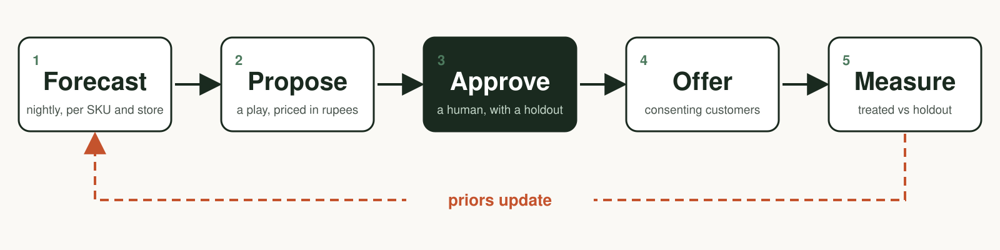

# Taal

Forecast, propose, approve, offer, measure: one loop that sells at-risk stock before it is written off, with a holdout to prove it.

| Result on the judge path | Number |
|---|---|
| 28-day portfolio, expected margin | **₹347,356** projected at the 5% default response prior (₹1.41 to 6.19 lakh across the 2% to 10% priors); seeded tenant, projected |
| Hero play, recovered vs doing nothing | **₹9,191**, the estimator's figure, projected on a seeded tenant (one tea lot, 103 units) |
| Beat over a blanket 20% markdown | **+₹6,186**, derived: the blanket markdown's loss minus the play's loss |
| Customers treated / held out | 355 / 39 (synthetic orders; the effect is not measured yet) |
| Approve | about 3 to 7 s (measured 12 Oct after #90; first call after idle takes longer) |
| Plan live | 22 of 24 model-planned on `gemini-3.5-flash`; planner p50 26.5 s, p95 31.8 s (11 Oct) |
| Planner evalsets | 46 recorded-run regression guard; response match **43/46 (93%)** on `gemini-3.5-flash`, 12 Oct, planner prompt v6 (38/46 on `gemini-2.5-flash`, 9 Oct); first proposed play passed the gate **41/46** (5/46 on 9 Oct); exact tool trajectory 1/46 (6/46 on 9 Oct), why in [Evaluation](#evaluation) |
| Tests and CI gate | 470+ pytest and 490+ Playwright tests in `make verify` (`.github/workflows/verify.yml`) |
| 60-second judge path | 3 clicks: Run the 60-second beat, Approve, Chat as Ravi |

[Live app](https://taal-web-2obkp776ca-el.a.run.app) · [Deck](docs/deck.pdf) · Video (link added at submission) · [API health](https://taal-agents-2obkp776ca-el.a.run.app/health)

## What it is

Retail & Commerce entry for the Google Cloud AI Builder Cup 2026 (JAPAC). Taal forecasts stock per SKU and dark store every night, finds lots that will miss their online sell-by, and proposes a play for each. Gemini 3.5 Flash plans the play in an ADK agent; plain code prices every rupee and runs eight guardrails. Approval assigns a holdout, so the result can be measured.



## Judge quick-start

Open https://taal-web-2obkp776ca-el.a.run.app (first load takes 8 to 12 s). The demo clock is pinned to 12 Sep 2026, so the 6 Oct sell-by is in the future of the demo.
1. Click **Run the 60-second beat**. The Darjeeling Tea card (`gap_tea_ds04`) shows 103 units, ₹35,020 at stake, 24 days to the online sell-by.
2. Click **Approve** (about 3 to 7 s, measured 12 Oct; first call after idle takes longer). The headline reads "Recovered vs doing nothing ₹9,191", with 355 customers treated and 39 held out (394 consented; seeded). The play still nets -₹25,829 against ₹35,020 at stake; ₹9,191 is the improvement over doing nothing (projected, seeded).
3. Click **Chat as Ravi**: the follow-up button that appears after Approve on the Tea beat (the chat default is Meena, the chips play's customer). The offer arrives; then click **Send** and **Add to cart**: the order total is ₹450. Chat answers come from the inventory tool and carry the best-before date.

- Reset demo data restores the seeded tenant for your visitor only.
- Live re-plan about 27 s; latency evidence in [`eval/evaluation.md`](eval/evaluation.md#latency-one-story-gemini-35-flash-12-oct-2026).
- Try it locally: `make setup`, then `make api` and `make web` (see Development below).

## How Gen AI is used

Gemini 3.5 Flash on Vertex AI plans each play inside an ADK agent: it proposes the mechanic, audience and reasoning; plain code prices every rupee, runs eight guardrails, assigns the holdout and measures the lift. A proposal that fails a guardrail is sent back for a revision (up to 3 iterations) instead of being shown.

| Component | Model (id in `config/models.toml`) | What it decides | Deliberately not LLM |
|---|---|---|---|
| Vision intake | `flash` | SKU, best-before date, facings, confidence | which rows need confirmation; the sell-by date (rule) |
| Planner | `flash` in a LoopAgent | mechanic, audience, rationale, revision after a failed guardrail | every rupee (estimator), guardrails, holdout |
| Copy | `flash` via BigQuery `AI.GENERATE_TABLE` (vertex backend only), started in the background when a play is proposed or opened; Approve uses it if it is ready within a 3 s budget, otherwise templated copy ships. The response names which one (`copy.source`: `bigquery`, `templated` or `existing`) | vernacular variants when the BigQuery call returns in time | discount values, best-before disclosure (validator; runs on generated and templated copy alike) |
| Customer agent | `flash` | dialogue, substitution reasoning | stock, offer eligibility, arm, consent, order prices |
| Measure, Sense, Approve | none | | lift, CI, priors, assignment, forecast |

`TAAL_MODEL_BACKEND=stub` (the default, what CI runs) replaces Gemini with scripted models that follow the same tool protocol; `vertex` uses the pinned Gemini ids through Vertex AI (ids live only in `config/models.toml`).

**Recorded trace.** The 60-second beat opens on `gap_tea_ds04`: 103 units of Darjeeling Tea at dark store DS-04, ₹35,020 at stake, online sell-by 6 October 2026. Its Desk trace is a committed Gemini recording (`gemini-3.5-flash`, planner prompt v7), badged `Recorded from Gemini · 12 Oct 2026`: the pinned run `c/run_02` made one `propose_play` attempt, accepted first time with no rejection, in 26.8 s (`eval/raw/planner_real_traces_tea_2026-10-12c/`; pin in `eval/raw/seed_pins.json`). The play transfers the 103 units to OUT-01, nudges 394 consented customers and passes all eight guardrails. ₹9,191 is the estimator's recovered-versus-doing-nothing figure (waste avoided ₹9,397 minus transfer cost ₹206); the play still nets -₹25,829 against ₹35,020 at stake. ₹6,186 is derived, not a stored estimator field: the blanket 20% markdown's loss (₹32,015) minus the play's loss (₹25,829), a sum that `cite_or_drop` accepts when the final proposal's rationale states it (`agents/gate/guardrails.py`). Only that final rationale is checked: the earlier `check_guardrails` call in the trace ran on a draft with an empty rationale, so it cites no numbers. The second recorded gap, `gap_chips_ds07`, does not beat a blanket markdown (about ₹279 worse; the Desk shows both); its recording holds one schema slip, not a guardrail rejection. Details: [`docs/hero_plays.md`](docs/hero_plays.md).

## What it does

**Capture** (pallet photo, confidence-scored, low rows confirmed) → **Sense** (nightly per-SKU forecasts, six gap types with rupees at stake) → **Plan** (ADK LlmAgent in a LoopAgent, max 3 iterations, six deterministic tools, eight guardrails) → **Approve** (holdout, best-before copy, offers for treated customers only) → **Engage** (Customer Agent grounded in stock, offers and consent; MCP orders; STOP withdraws consent) → **Measure** (treated vs holdout with a 95% CI; `unmeasured` when the treated arm is too small; priors updated).

## The hook

FSSAI, India's food regulator, sent e-commerce food business operators an advisory on 3 December 2024 ([file no. RCD-13/1/2024-Regulatory-FSSAI(E-13150)](https://fssai.gov.in/upload/advisories/2024/12/674efa161d756Adobe%20Scan%203%20Dec%202024.pdf), paragraph 4): "FSSAI mandates that products must have a minimum shelf life of 30% or at least 45 days before expiry, at the time of delivery." It is an advisory, not a gazetted rule, and it leaves open 30% of what. **The reading below is Taal's configurable default, not FSSAI text.** Taal applies it as a tenant-set, versioned rule (`config/tenant.demo.toml`, `sellby_rule`): a 90-day-shelf-life pack of chips that expires in **33 days** needs 27 days left (30% of 90) and can be sold online for **6** more days. Forecasting tools treat expiry as the deadline; Taal makes the online sell-by cut-off a first-class gap type, shown on every gap card.

## Impact in numbers

Measured 24 Sep 2026 on the seeded tenant; every number comes from a committed evidence file (full table: [`docs/impact_numbers.md`](docs/impact_numbers.md)).

| What | Number | Label | Source |
|---|---|---|---|
| 28-day exposure, one Sense run (555 gaps, incl. 5 assortment rows the generator no longer makes) | ₹1,795,464 | seeded | `eval/raw/portfolio_2026-09-24.json` |
| Plays planned | 424 | seeded | same file |
| Expected margin per 28-day run at the default 5% response prior (sales margin ₹206,205 plus write-off avoided ₹141,151) | ₹347,356 | projected | same file; `docs/impact_math.md` |
| The same estimate at a 2% / 10% response prior instead of 5% (550 grocery gaps; 421 / 423 plays) | ₹140,728 / ₹619,165 | projected | `eval/raw/portfolio_prior_sensitivity_2026-10-09.json` |
| Monthly run cost, usage to 23 Sep 2026 on gemini-2.5-flash, no plays in the window, list-priced | ₹486 | measured usage; not a bill | `eval/raw/cost_measurement_2026-09-23.json` |
| Forecast backtest: synthetic tenant / public non-grocery data | WAPE 0.113 / 0.83 | seeded / public | `eval/raw/external_backtest_2026-10-09.json`; [`eval/external_backtest.md`](eval/external_backtest.md) |

India scale (Inc42 on Blinkit's inventory losses), buyer and pricing basis, and the projected margin less run cost per node: [`docs/impact_numbers.md`](docs/impact_numbers.md). No price point is set until a pilot measures the lift; nothing here is a quote.

## Screenshots

Six captures of the judge path (landing, gap card, approved chart, Play Desk, phone intake, Outcomes), all rendered locally and none a real camera photo: [`docs/screenshots.md`](docs/screenshots.md).

## Architecture


Two paths: a per-visitor sandbox serves judges, and nightly Cloud Run jobs run on BigQuery
(source and request paths in [`docs/architecture.md`](docs/architecture.md)).

## What is real, what is simulated

Every panel carries a LIVE, REPLAY or SYNTHETIC badge; the Desk's trace names its source (`Recorded from Gemini · <date>`, `Scripted fixture`, `Rules (fallback)` or `Live · Gemini`). Approve, chat and capture are live calls; Sense is nightly and replayed. **Change policy → re-plan** is a live, streamed Gemini call on the deployed service. The judge-mode data is a frozen local snapshot per visitor; Reset restores it. BigQuery batch path status and the 27 Sep incidents: [eval/incidents_2026-09-27.md](eval/incidents_2026-09-27.md).

| Part | Status | What it is, and the evidence |
|---|---|---|
| Forecasts, gaps, estimator, guardrails, planner loop | Real | Local forecaster (`jobs/sense/forecast.py`), gap detector, estimator, eight guardrails and the ADK planner run for real. |
| Approve, chat, orders, measurement code | Real | Assignment by hash, re-forecast, chat with Gemini, MCP orders, the lift and CI code. |
| Nightly BigQuery jobs | Real, not on the judge path | `AI.FORECAST` lost 45/45 head-to-head to the local forecaster, so the judge path uses the local one; `taal-sense` still runs it nightly (`eval/raw/bigquery_ai_forecast_2026-09-27/head_to_head_summary.json`). |
| Kutumb Mart tenant | Seeded | 300 grocery SKUs, 10 dark stores, 6 outlets, 4,000 customers, 70 days of sales (`eval/raw/docs_truth_sweep_2026-09-27/tenant_counts.json`). |
| Tea and chips plays | Seeded (recorded Gemini runs) | Committed recordings: Tea 12 Oct (pinned run `c/run_02`, `eval/raw/planner_real_traces_tea_2026-10-12c/`), chips 10 Oct (`eval/raw/planner_real_traces_2026-10-10/`). |
| Cola, kaju and quinoa plays | Seeded (scripted fixture) | From the scripted planner fixture (`infra/Dockerfile.api`). |
| Expected margin and write-off avoided after Approve | Projected | At the default response prior; a projection on a seeded tenant. |
| Outcomes screen | Synthetic | Labelled SYNTHETIC until a pilot runs (`docs/pilot.md`). |

Deployment caveat: `taal-agents` runs with `--max-instances 1` (`infra/deploy.sh:239`) because each visitor's sandbox is on the instance's local disk (`services/api/sandbox.py`) and re-plan run state is in process memory; a second instance would answer a poll with 404. `min-instances` is 0, so the first request after idle is slower.

## Scale, cost and pilot

- **Scale (estimate):** a Large profile (20,000 SKUs, 500 nodes, 1M customers) keeps the same shape; no tenant that size has run, so throughput is not measured. What breaks first is `--max-instances 1` (caveat above), then the Planner queue, then the in-process re-forecast ([`docs/scale.md`](docs/scale.md)).
- **Run cost:** ₹486 a month measured on `gemini-2.5-flash` (usage to 23 Sep 2026, no plays in the window, not a bill; not re-measured on `gemini-3.5-flash`). Estimates: Micro ₹200 to 500, Mid ₹2,500 to 5,000, Large ₹1 to 2 lakh.
- **Pilot design:** 50 to 60 consented testers for one week, a 40 to 50% holdout, the metric pre-registered, results labelled apart from seeded numbers ([`docs/pilot.md`](docs/pilot.md)). Nothing has been measured on real customers yet.

## Not in this submission

Voice (Gemini Live) is not part of this submission: it is a documented stub with no tests, and the phone view's microphone button is disabled.

## Bring your own data

Three CSV files and one `data.ingest` command flag every lot under your online sell-by rule, with rupees at stake; nothing leaves the machine: [`docs/bring_your_own_data.md`](docs/bring_your_own_data.md).

## Evaluation

[`eval/evaluation_table.md`](eval/evaluation_table.md) is the submission table (`make eval-table`): every cell is parsed from committed output, and rows this project cannot produce yet say so. From 10 Oct 2026 the live model is `gemini-3.5-flash` in asia-south1 (`gemini-2.5-flash` retires on Vertex on 20 Oct 2026), fallback `gemini-3.5-flash-lite` (`eval/raw/model_verification_2026-10-10.json`).

**Planner ADK eval, re-run 12 Oct 2026** (`eval/raw/live_eval_2026-10-12/`): response match **43/46 (93%)** on `gemini-3.5-flash`, planner prompt v6 (38/46 on `gemini-2.5-flash`, 9 Oct); exact tool trajectory **1/46** (6/46 on 9 Oct); rationale judge 15/15, mean 5.0, by a same-family judge (weak evidence). Prompt v7 (the Tea recording's prompt) was not measured. The 46 evalsets are 28 Sep recordings from `gemini-2.5-flash`; 41 of the 45 trajectory failures expect two or more `propose_play` attempts, while `gemini-3.5-flash` proposed first time in 40 of those 45, so the strict score measures departure from the old retry pattern, not planner quality. Each retry is a play the gate refused (schema, guardrails or money checks), so the retry count is the measure that matters: the first proposed play passed the gate in **41/46** cases on `gemini-3.5-flash`, against 5/46 on `gemini-2.5-flash` on 9 Oct and 2/46 in the recordings, and `check_guardrails` ran before the proposal in 46/46 (23/46 on 9 Oct) (`eval/raw/live_eval_2026-10-12/first_attempt.json`, `harness/first_attempt_acceptance.py`). The gate changed between the two runs (it now re-derives audience and estimate), so the five fully recorded `gemini-2.5-flash` runs were replayed through today's gate: it still rejects all five first attempts. Five runs is a small check, not proof. Also computed from the stored results: in all 46 cases it called every expected tool and ended with `propose_play`; IN_ORDER and ANY_ORDER matching are both 5/46, for the same retry reason. The set is a regression guard against recorded behaviour, not an accuracy score, and it has not been re-recorded. The 3 response misses are recordings that ended in an empty final turn; the model returned a play in all three.

The other eval cards (agent simulation, vision, customer latency, the ₹486 cost) ran on `gemini-2.5-flash` before the switch and have not been re-run. Latency and the 22-of-24 live plan run: [`eval/evaluation.md`](eval/evaluation.md#latency-one-story-gemini-35-flash-12-oct-2026).

## More documentation

- [`docs/design_notes.md`](docs/design_notes.md): why the loop generalizes beyond promos, and what Gemini decides versus what code never lets it decide.
- [`docs/vendors.md`](docs/vendors.md): how Taal differs from named vendors.
- [`docs/related_work.md`](docs/related_work.md): outside references, and consent and approval in AP2 vocabulary.
- [`docs/hero_plays.md`](docs/hero_plays.md): the Tea and chips recordings in detail.

## Team

| Name | Role |
|---|---|
| Nandish | Lead, product and engineering |
| Rinu | Co-builder |

## Development

```
make setup      # uv sync + npm ci
make verify     # secrets -> lint -> schemas -> generate -> unit -> sql -> agents -> api-test -> web-test -> docs -> status
make api        # FastAPI on :8080 against .local/data
make web        # Next.js on :3000 (NEXT_PUBLIC_TAAL_MOCK=1 for fixtures only)
make fixtures   # rebuild committed golden plays, mutations, golden runs, evalsets
make openapi    # regenerate docs/openapi.yaml
```

Green `make verify` (470+ pytest and 490+ Playwright tests, the CI gate in `.github/workflows/verify.yml`) is the only definition of done. Specs and design: `docs/DECISIONS.md`, `docs/DATA_MODEL.md`, `docs/architecture.md`, `docs/scale.md`, `docs/pilot.md`, `docs/privacy.md`, `docs/openapi.yaml`.

## Licence

MIT for code (`LICENSE`). Third-party data terms in `DATA_LICENSES.md`.
